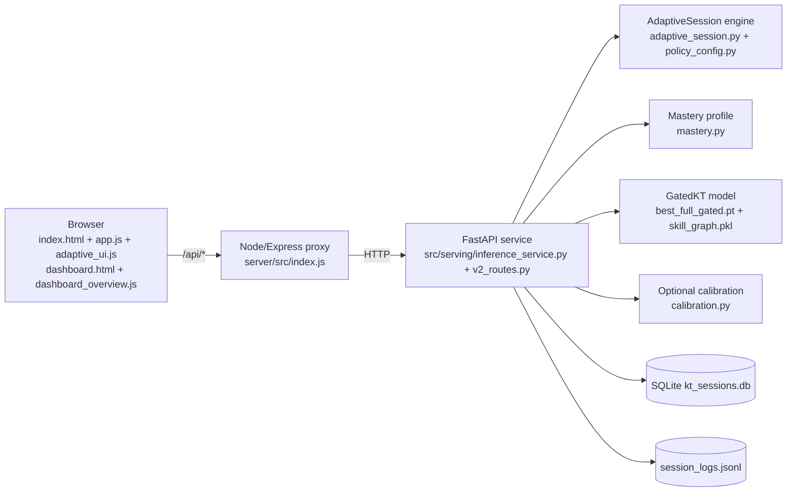

# GatedKT adaptive assessment

GatedKT is a dynamic maths assessment built around a knowledge-tracing model. Before every question the model predicts the student's probability of answering correctly. That prediction (blended with the student's own record on each topic) chooses the next **topic**; the **difficulty level** (Easy / Medium / Hard) follows a staircase in the demo configuration, with an optional model-guided policy. Answers from earlier sessions carry over. After each answer the student's history is updated. At the end the system shows a per-topic **mastery / readiness profile** (Not enough evidence / Needs support / Developing / Proficient / Mastered, plus "ready for harder questions"). Teachers see a class overview with a grouped "Needs attention" panel.

This is an **integrated, evaluated system built from standard parts** (knowledge tracing, a skill-relation graph, a learned gate, adaptive difficulty). It is not a new model architecture. See [docs/PROJECT_OVERVIEW.md](docs/PROJECT_OVERVIEW.md) for what is and is not new, and [docs/LIMITATIONS.md](docs/LIMITATIONS.md).

## What v3 adds (faculty feedback)

| Feedback | What v3 does | Evidence |
|---|---|---|
| Many seeds, report variance | 100 seeds for 7 classical baselines (random re-splits); 10 seeds for 11 deep models / ablations at a reduced, equal budget, plus a 1000-resample bootstrap over test students; mean, std, variance, 95% CI | [reports/v3/benchmark_classical.md](reports/v3/benchmark_classical.md), [reports/v3/benchmark.md](reports/v3/benchmark.md) |
| More baselines | majority, skill mean, logistic regression on counts, PFA, Elo, BKT (own EM), BKT+difficulty, DKT (classic / GRU / LSTM), DKVMN-lite, SAKT-lite, plus our ablations | [docs/BASELINES.md](docs/BASELINES.md) |
| Learner levels | sections primary / secondary / undergraduate with grade labels, topics, difficulty parameters and a validation label | `src/serving/sections.py`, [reports/v3/by_band.md](reports/v3/by_band.md) |
| Compare with existing solutions | paired significance tests against every baseline; related-work table | [reports/v3/benchmark.md](reports/v3/benchmark.md), [docs/RELATED_WORK_TABLE.md](docs/RELATED_WORK_TABLE.md) |
| Random parametric questions | seeded offline generator driven by difficulty parameters, numeric / fraction / multiple-choice answers | [docs/QUESTION_GENERATOR.md](docs/QUESTION_GENERATOR.md), [reports/v3/generator_check.md](reports/v3/generator_check.md) |
| Stronger, no false claims | real external data (Eedi) for primary/secondary, pre-registered policy gates, honesty audit | [reports/v3/external_benchmark.md](reports/v3/external_benchmark.md), [reports/v3/DEMO_CONFIG.md](reports/v3/DEMO_CONFIG.md), [reports/v3/FINAL_REPORT.md](reports/v3/FINAL_REPORT.md) |

Headline (all numbers from reports/v3): with the same reduced training budget, the full gated model is significantly better than every classical baseline, SAKT-lite, DKVMN-lite and DKT-GRU/LSTM, but only comparable to classic DKT and to its own no-graph ablation; on the real Eedi data it is comparable to DKT and Elo. See [docs/RESULTS_SUMMARY.md](docs/RESULTS_SUMMARY.md).

## Architecture



Per question: history (all sessions) -> `predict_candidates` scores every eligible topic -> topic with the lowest estimate is chosen (model prediction, or blended with the student's record when TOPIC_SELECTION=evidence_blend) -> level: staircase (default and demo) or POLICY=model (allowed levels follow the student's answers; the one closest to 70% predicted success) -> the prediction is shown before answering -> answer stored -> next question. Every question carries a `decision` object with the numbers behind the choice, shown in the "How the system is adapting" panel and written to the log.

## Setup

Requirements: Python 3.11, Node.js 18+ (tested with 24), Chrome or Edge for the optional browser QA.

```bash
python -m venv .venv
.venv/Scripts/python -m pip install -r requirements.txt --extra-index-url https://download.pytorch.org/whl/cpu   # Windows path; use .venv/bin/python on macOS/Linux
.venv/Scripts/python -m pip install -r requirements-serving.txt   # fastapi, uvicorn, pytest, httpx (missing from requirements.txt)
cd server && npm ci && cd ..
```

(`requirements.txt` is UTF-16 encoded; pip reads it fine.)

## Run

```bash
.venv/Scripts/python scripts/start_demo.py              # demo configuration from demo.env
.venv/Scripts/python scripts/start_demo.py --defaults   # original behaviour (staircase, 10 topics, no calibration)
```

Then open `http://127.0.0.1:3000/` (quiz) and `http://127.0.0.1:3000/dashboard.html` (teacher view).

`demo.env` is now produced by `scripts/apply_gates_v3.py` from the pre-registered v3 gates ([reports/v3/DEMO_CONFIG.md](reports/v3/DEMO_CONFIG.md)): `POLICY=uncertainty` (passed Gate P; in simulation it falls back to the staircase on most decisions and flags them as low-confidence), `QUESTION_SOURCE=mixed` (passed Gate Q), and from v2 ([reports/DEMO_CONFIG.md](reports/DEMO_CONFIG.md)) `APPLY_CALIBRATION=true`, `SESSION_MODE=core5`, `TOPIC_SELECTION=evidence_blend`, `TARGET_P=0.70`. All settings are environment variables documented in `src/serving/policy_config.py`; their defaults are the original behaviour.

Learner level: the login card has a "Learner level" picker (default = the original 10 topics). Primary and secondary are labelled "validated on real data"; undergraduate is "transfer mode, not validated". Only secondary uses the served model's predictions; primary and undergraduate sessions are evidence-only (see docs/DECISIONS.md D35, D37).

Optional simulated demo students for the dashboard's "Simulated demo" view (clearly labelled, ids `sim_*`):

```bash
.venv/Scripts/python scripts/seed_demo_data.py --yes-real-db           # add 12 simulated students
.venv/Scripts/python scripts/seed_demo_data.py --remove --yes-real-db  # remove them again
```

## v3 experiments

```bash
.venv/Scripts/python scripts/benchmark_seeds.py classical --seeds 100 --workers 5     # Stage 4, ~8 min
.venv/Scripts/python scripts/benchmark_seeds.py deep --seeds 10 --epochs 5 --workers 6 # Stage 5, ~45 min (cached; resumable)
.venv/Scripts/python scripts/benchmark_seeds.py report                                 # rebuild benchmark.md from cached predictions
.venv/Scripts/python scripts/build_by_band.py                                          # per-grade-band AUC
.venv/Scripts/python scripts/fetch_datasets.py                                         # public downloads, else docs/DATASETS_TODO.md
.venv/Scripts/python scripts/run_external_benchmark.py --seeds 3 --epochs 4            # Eedi per section + transfer, ~9 min
.venv/Scripts/python scripts/check_generator.py                                        # question generator report
.venv/Scripts/python scripts/simulate_v3.py --students 100 --seed 2026 --exploratory   # policy comparison, ~2 min
.venv/Scripts/python scripts/apply_gates_v3.py                                         # pre-registered gates -> demo.env
.venv/Scripts/python scripts/run_tests_v3.py                                           # all pytest + Node suites, new-failure check
.venv/Scripts/python scripts/e2e_http_check.py --only demo,mixed,section_primary,section_secondary --out-dir reports/v3
.venv/Scripts/python scripts/visual_qa_v3.py --env-file demo.env --sections primary,secondary
```

## Tests

```bash
.venv/Scripts/python -m pytest tests -q        # uses temp copies of the DB and log (tests/conftest.py)
cd server && node tests/test_v2_routes.js      # proxy routes against a fake upstream (no Python needed)
.venv/Scripts/python scripts/e2e_http_check.py # real FastAPI + Node, scripted sessions, contract checks
.venv/Scripts/python scripts/visual_qa.py --env-file demo.env --seed-sim   # needs: npm install --prefix .tools/qa puppeteer-core@23
```

The legacy Node smoke tests (`server/tests/test_server.js`, `test_frontend_smoke.js`, `test_dashboard_smoke.js`) and 15 legacy pytest tests already failed before this upgrade: they drive the old fixed 10-question flow, which the adaptive service no longer supports. They were left unchanged. Details in [reports/FINAL_REPORT.md](reports/FINAL_REPORT.md).

## Reports

| Report | What it shows |
|---|---|
| [reports/v3/FINAL_REPORT.md](reports/v3/FINAL_REPORT.md) | **v3**: stage status, tests, benchmark and policy tables, gates, weaknesses, commands |
| [reports/v3/benchmark.md](reports/v3/benchmark.md) / [benchmark_classical.md](reports/v3/benchmark_classical.md) | **v3**: multi-seed benchmark, bootstrap, paired significance tests, ablations |
| [reports/v3/external_benchmark.md](reports/v3/external_benchmark.md) / [datasets.md](reports/v3/datasets.md) | **v3**: Eedi data per learner level, cross-level transfer |
| [reports/v3/policy_comparison.md](reports/v3/policy_comparison.md) | **v3**: six difficulty policies on paired synthetic students |
| [reports/v3/by_band.md](reports/v3/by_band.md), [generator_check.md](reports/v3/generator_check.md), [ui_check.md](reports/v3/ui_check.md), [e2e_http_check.md](reports/v3/e2e_http_check.md) | **v3**: per-band AUC, generator check, browser and HTTP checks |
| [reports/FINAL_REPORT.md](reports/FINAL_REPORT.md) | v2: task status, tests, gates, headline results, weaknesses |
| [docs/RESULTS_SUMMARY.md](docs/RESULTS_SUMMARY.md) | One-page headline numbers |
| [reports/monotonicity.md](reports/monotonicity.md) | Does the model order Easy >= Medium >= Hard? |
| [reports/calibration.md](reports/calibration.md) | Temperature scaling: Brier / ECE / AUC before and after |
| [reports/simulation.md](reports/simulation.md) + [notes](reports/simulation_notes.md) | Random vs staircase vs model-guided difficulty on synthetic students |
| [reports/answer_response.md](reports/answer_response.md) | How the prediction reacts to correct/wrong answers |
| [reports/DEMO_CONFIG.md](reports/DEMO_CONFIG.md) | Gate decisions behind demo.env |
| [reports/e2e_http_check.md](reports/e2e_http_check.md) | End-to-end API contract check through the real services |
| [reports/pilot.md](reports/pilot.md) | Analysis of real session logs (so far mostly developer/tester sessions; not pilot evidence) |
| [reports/screenshots/](reports/screenshots/) | Browser QA screenshots at 1280px and 375px |
| [ADAPTIVE_KT_REPORT.md](ADAPTIVE_KT_REPORT.md) | Earlier model work: retraining and AUC ablation |

Documentation: [BASELINES](docs/BASELINES.md) · [QUESTION_GENERATOR](docs/QUESTION_GENERATOR.md) · [RELATED_WORK_TABLE](docs/RELATED_WORK_TABLE.md) · [DATASETS_TODO](docs/DATASETS_TODO.md) · [ARCHITECTURE_NOTES_v3](docs/ARCHITECTURE_NOTES_v3.md) · [PROJECT_OVERVIEW](docs/PROJECT_OVERVIEW.md) · [DEMO_SCRIPT](docs/DEMO_SCRIPT.md) · [VIVA_QA](docs/VIVA_QA.md) · [LIMITATIONS](docs/LIMITATIONS.md) · [PILOT_GUIDE](docs/PILOT_GUIDE.md) · [DECISIONS](docs/DECISIONS.md) · [ARCHITECTURE_NOTES](docs/ARCHITECTURE_NOTES.md) · [BUILD_LOG](docs/BUILD_LOG.md)

Rehearsal: `.venv/Scripts/python scripts/dry_run.py --seed 1` plays a strong, a struggling, a mixed and a returning student through the real API on a temporary database.
