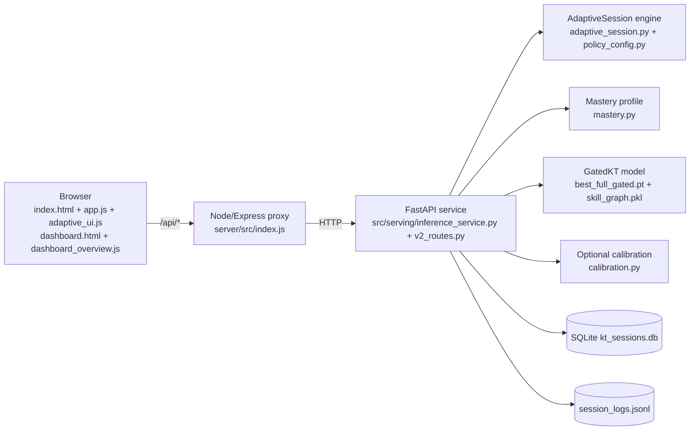

# GatedKT adaptive assessment

GatedKT is a dynamic maths assessment built around a knowledge-tracing model. Before every question the model predicts the student's probability of answering correctly. That prediction chooses the next **topic**, and (in the demo configuration) the **difficulty level** (Easy / Medium / Hard). After each answer the student's history is updated. At the end the system shows a per-topic **mastery / readiness profile** (Not enough evidence / Needs support / Developing / Proficient / Mastered, plus "ready for harder questions"). Teachers see a class overview with a "Needs attention" list.

This is an **integrated, evaluated system built from standard parts** (knowledge tracing, a skill-relation graph, a learned gate, adaptive difficulty). It is not a new model architecture. See [docs/PROJECT_OVERVIEW.md](docs/PROJECT_OVERVIEW.md) for what is and is not new, and [docs/LIMITATIONS.md](docs/LIMITATIONS.md).

## Architecture



Per question: history -> `predict_candidates` scores every eligible topic -> lowest predicted P(correct) topic is chosen -> level: staircase (default) or the level whose predicted P is closest to 70% (POLICY=model, with guardrails) -> the prediction is shown before answering -> answer stored -> next question. Every question carries a `decision` object with the numbers behind the choice, shown in the "How the system is adapting" panel and written to the log.

## Setup

Requirements: Python 3.11, Node.js 18+ (tested with 24), Chrome or Edge for the optional browser QA.

```bash
python -m venv .venv
.venv/Scripts/python -m pip install -r requirements.txt --extra-index-url https://download.pytorch.org/whl/cpu   # Windows path; use .venv/bin/python on macOS/Linux
.venv/Scripts/python -m pip install -r requirements-serving.txt   # fastapi, uvicorn, pytest, httpx (missing from requirements.txt)
cd server && npm ci && cd ..
```

(`requirements.txt` is UTF-16 encoded; pip reads it fine.)

## Run

```bash
.venv/Scripts/python scripts/start_demo.py              # demo configuration from demo.env
.venv/Scripts/python scripts/start_demo.py --defaults   # original behaviour (staircase, 10 topics, no calibration)
```

Then open `http://127.0.0.1:3000/` (quiz) and `http://127.0.0.1:3000/dashboard.html` (teacher view).

`demo.env` was produced mechanically by `scripts/apply_gates.py` from pre-registered decision gates ([reports/DEMO_CONFIG.md](reports/DEMO_CONFIG.md)): `POLICY=model`, `APPLY_CALIBRATION=true`, `SESSION_MODE=core5`, `TARGET_P=0.70`. All settings are environment variables documented in `src/serving/policy_config.py`.

Optional simulated demo students for the dashboard's "Simulated demo" view (clearly labelled, ids `sim_*`):

```bash
.venv/Scripts/python scripts/seed_demo_data.py --yes-real-db           # add 12 simulated students
.venv/Scripts/python scripts/seed_demo_data.py --remove --yes-real-db  # remove them again
```

## Tests

```bash
.venv/Scripts/python -m pytest tests -q        # uses temp copies of the DB and log (tests/conftest.py)
cd server && node tests/test_v2_routes.js      # proxy routes against a fake upstream (no Python needed)
.venv/Scripts/python scripts/e2e_http_check.py # real FastAPI + Node, scripted sessions, contract checks
.venv/Scripts/python scripts/visual_qa.py --env-file demo.env --seed-sim   # needs: npm install --prefix .tools/qa puppeteer-core@23
```

The legacy Node smoke tests (`server/tests/test_server.js`, `test_frontend_smoke.js`, `test_dashboard_smoke.js`) and 15 legacy pytest tests already failed before this upgrade: they drive the old fixed 10-question flow, which the adaptive service no longer supports. They were left unchanged. Details in [reports/FINAL_REPORT.md](reports/FINAL_REPORT.md).

## Reports

| Report | What it shows |
|---|---|
| [reports/FINAL_REPORT.md](reports/FINAL_REPORT.md) | Task status, tests, gates, headline results, weaknesses |
| [docs/RESULTS_SUMMARY.md](docs/RESULTS_SUMMARY.md) | One-page headline numbers |
| [reports/monotonicity.md](reports/monotonicity.md) | Does the model order Easy >= Medium >= Hard? |
| [reports/calibration.md](reports/calibration.md) | Temperature scaling: Brier / ECE / AUC before and after |
| [reports/simulation.md](reports/simulation.md) + [notes](reports/simulation_notes.md) | Random vs staircase vs model-guided difficulty on synthetic students |
| [reports/DEMO_CONFIG.md](reports/DEMO_CONFIG.md) | Gate decisions behind demo.env |
| [reports/e2e_http_check.md](reports/e2e_http_check.md) | End-to-end API contract check through the real services |
| [reports/pilot.md](reports/pilot.md) | Analysis of real session logs (currently "not meaningful yet") |
| [reports/screenshots/](reports/screenshots/) | Browser QA screenshots at 1280px and 375px |
| [ADAPTIVE_KT_REPORT.md](ADAPTIVE_KT_REPORT.md) | Earlier model work: retraining and AUC ablation |

Documentation: [PROJECT_OVERVIEW](docs/PROJECT_OVERVIEW.md) · [DEMO_SCRIPT](docs/DEMO_SCRIPT.md) · [VIVA_QA](docs/VIVA_QA.md) · [LIMITATIONS](docs/LIMITATIONS.md) · [PILOT_GUIDE](docs/PILOT_GUIDE.md) · [DECISIONS](docs/DECISIONS.md) · [ARCHITECTURE_NOTES](docs/ARCHITECTURE_NOTES.md) · [BUILD_LOG](docs/BUILD_LOG.md)
