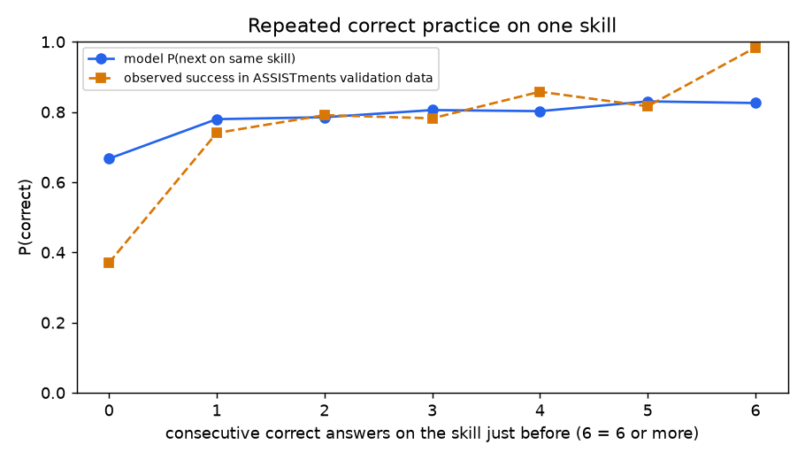

# How the prediction reacts to answers (cross-check)

Generated 2026-10-09 05:53 UTC by `scripts/check_answer_response.py` (seed 5). Served model, uncalibrated predictor, ASSISTments validation split.

## 1. Correct vs wrong last answer (everything else identical)

| next question | cases | mean P(after correct) - P(after wrong) | share where a correct answer gives a LOWER P |
|---|---|---|---|
| same skill as the last answer | 261 | +0.215 | 3.4% |
| different skill | 139 | +0.531 | 5.0% |

## 2. Repeated correct answers on one skill

| consecutive correct before | model P (mean over prefixes) | observed success in data | observed n |
|---|---|---|---|
| 0 | 0.667 | 0.370 | 8180 |
| 1 | 0.780 | 0.740 | 4576 |
| 2 | 0.785 | 0.791 | 2421 |
| 3 | 0.805 | 0.782 | 1302 |
| 4 | 0.802 | 0.858 | 850 |
| 5 | 0.830 | 0.816 | 381 |
| 6+ | 0.826 | 0.984 | 5674 |

## 3. Quiz topics: Easy prediction before any answer on the topic vs after one answer

| topic | before | after 1 correct | after 1 wrong |
|---|---|---|---|
| Percents | 0.97 | 0.74 | 0.63 |
| Percent Discount | 0.97 | 0.75 | 0.62 |
| Rate | 0.97 | 0.76 | 0.59 |
| Polynomial Factors | 0.98 | 0.78 | 0.31 |
| Simplifying Expressions positive exponents | 0.99 | 0.88 | 0.60 |
| Solving Systems of Linear Equations | 0.96 | 0.47 | 0.28 |
| Solving Systems of Linear Equations by Graphing | 0.97 | 0.85 | 0.50 |
| Pythagorean Theorem | 0.98 | 0.81 | 0.65 |

