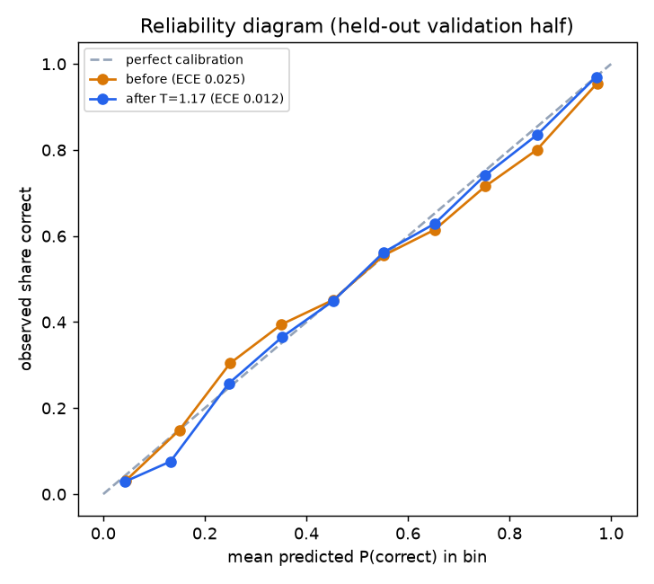

# Calibration (T8b): temperature scaling

Generated 2026-10-09 04:16 UTC by `scripts/fit_calibration.py` (seed 11, 10s).

Data: windowed_data.pkl validation split, next-step predictions of the served model (`best_full_gated.pt`). Students split 50/50: T fitted on half A (17320 predictions), metrics on held-out half B (18204 predictions).

Fitted temperature T = **1.1670** (T > 1 softens, T < 1 sharpens predictions).

| Metric (held-out half B) | before | after |
|---|---|---|
| Brier score | 0.1183 | 0.1176 |
| ECE (10 equal-width bins) | 0.0249 | 0.0117 |
| AUC | 0.8946 | 0.8946 |

ECE relative improvement: 53.2%. AUC unchanged (asserted).

**Gate C (pre-registered: ECE improves >= 10% relative and AUC unchanged): PASSES** -> demo APPLY_CALIBRATION = true.

Caveat: calibration is measured on ASSISTments validation data. The quiz uses generated template questions, so calibration on real quiz answers can only be checked with pilot data (scripts/analyze_logs.py).

## Reliability table (half B)

| bin | n | mean predicted before | observed | mean predicted after |
|---|---|---|---|---|
| 0.0-0.1 | 1839 | 0.044 | 0.032 | 0.043 (n=1270) |
| 0.1-0.2 | 638 | 0.150 | 0.149 | 0.133 (n=960) |
| 0.2-0.3 | 572 | 0.250 | 0.304 | 0.247 (n=649) |
| 0.3-0.4 | 669 | 0.351 | 0.395 | 0.353 (n=733) |
| 0.4-0.5 | 733 | 0.453 | 0.452 | 0.453 (n=839) |
| 0.5-0.6 | 949 | 0.553 | 0.555 | 0.553 (n=1130) |
| 0.6-0.7 | 1227 | 0.652 | 0.615 | 0.652 (n=1467) |
| 0.7-0.8 | 1625 | 0.752 | 0.716 | 0.752 (n=1924) |
| 0.8-0.9 | 2401 | 0.854 | 0.800 | 0.854 (n=2672) |
| 0.9-1.0 | 7551 | 0.973 | 0.955 | 0.971 (n=6560) |

