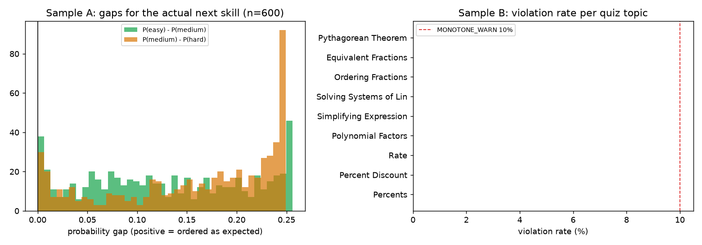

# Monotonicity check (T1)

Generated 2026-10-08 19:19 UTC by `scripts/check_monotonicity.py` (seed 7, 13s). Model loaded exactly as the service loads it (`best_full_gated.pt`).

Data source: **windowed_data.pkl validation split**. 600 (history prefix, skill) cases; prefixes of length 2..200.
Check: P(easy) >= P(medium) >= P(hard) with tolerance 0.005.

| Sample | cases | violation rate | P(easy)<P(medium) | P(medium)<P(hard) | mean gap easy-medium | mean gap medium-hard |
|---|---|---|---|---|---|---|
| A: actual next skill | 600 | 0.0% | 0.0% | 0.0% | +0.1301 | +0.1588 |
| B: 10 quiz topics | 6000 | 0.0% | 0.0% | 0.0% | +0.1669 | +0.1633 |

**Decision (Gate M, pre-registered):** violation_rate = max(A, B) = 0.0%; MONOTONE_WARN = 10% -> profile_reliable = **true**.

## Sample B per quiz topic

| Topic | id | cases | violation rate | mean gap easy-medium | mean gap medium-hard |
|---|---|---|---|---|---|
| Percents | 204 | 600 | 0.0% | +0.1763 | +0.1700 |
| Percent Discount | 203 | 600 | 0.0% | +0.1754 | +0.1718 |
| Rate | 217 | 600 | 0.0% | +0.1758 | +0.1716 |
| Polynomial Factors | 346 | 600 | 0.0% | +0.1779 | +0.1587 |
| Simplifying Expressions positive exponents | 371 | 600 | 0.0% | +0.1494 | +0.1662 |
| Solving Systems of Linear Equations | 350 | 600 | 0.0% | +0.1816 | +0.1483 |
| Solving Systems of Linear Equations by Graphing | 378 | 600 | 0.0% | +0.1812 | +0.1578 |
| Ordering Fractions | 50 | 600 | 0.0% | +0.1260 | +0.1545 |
| Equivalent Fractions | 48 | 600 | 0.0% | +0.1539 | +0.1685 |
| Pythagorean Theorem | 27 | 600 | 0.0% | +0.1718 | +0.1657 |

## Sample A: 10 most frequent next skills

| skill id | cases | violation rate | mean gap easy-medium | mean gap medium-hard |
|---|---|---|---|---|
| 47 | 50 | 0.0% | +0.1674 | +0.2120 |
| 280 | 44 | 0.0% | +0.0961 | +0.1345 |
| 311 | 42 | 0.0% | +0.1817 | +0.2078 |
| 18 | 34 | 0.0% | +0.1203 | +0.1865 |
| 277 | 32 | 0.0% | +0.1622 | +0.1766 |
| 70 | 20 | 0.0% | +0.1351 | +0.1081 |
| 13 | 19 | 0.0% | +0.0749 | +0.1018 |
| 79 | 18 | 0.0% | +0.1627 | +0.1987 |
| 279 | 18 | 0.0% | +0.0973 | +0.1438 |
| 85 | 16 | 0.0% | +0.0401 | +0.0641 |

Notes: difficulty buckets are per-problem tertiles of training-set success within each skill (1 = easy, 2 = medium, 3 = hard). The quiz templates' Easy/Medium/Hard levels only approximate these buckets, so a well-ordered model does not prove the quiz levels are equally spaced.

Interpretation caveat: the model adds a learned difficulty embedding to the target-skill representation, so a consistent ordering is expected by construction once training learned it. A low violation rate shows the ordering is stable across histories; it does NOT show that the size of the gaps is calibrated for this quiz's questions.
