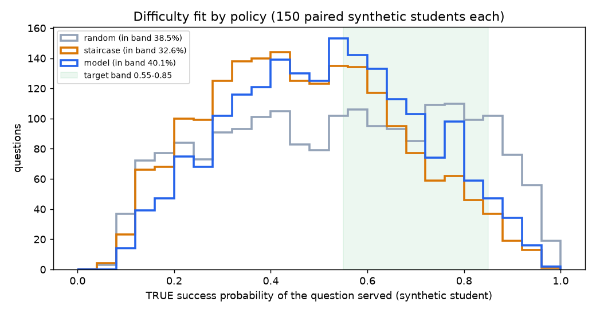
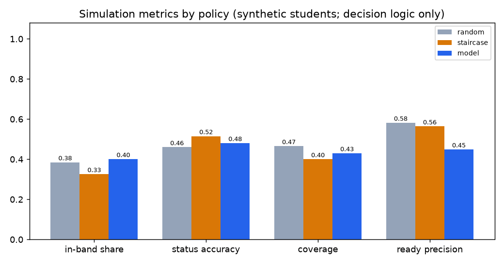

# Policy simulation (T6)

Generated 2026-10-09 06:08 UTC by `scripts/simulate.py` (seed 2026, 150 paired synthetic students per policy, 42s). Session mode full10, topic selection model; level rules as in adaptive_session.py (revised D27).

> **Scope.** Synthetic students are NOT drawn from the model's training distribution (ASSISTments). This validates the decision logic (which level gets served, how statuses are assigned) only. It says nothing about real learning gains and is not a test of knowledge-tracing accuracy.

Student model: g ~ N(0, 0.8); a_t = g + N(0, 0.7); P_true = 0.05 + 0.95 * sigmoid(a_t - b), b = easy -1 / medium 0 / hard +1. The real served predictor (`best_full_gated.pt`) drives topic choice and (for POLICY=model) the level. Profile mode: profile_reliable = true. Policy parameters were fixed before running (TARGET_P = 0.7, T_PROF = 0.7, T_READY = 0.6, MIN_ANSWERS = 2).

| Metric | random | staircase | model |
|---|---|---|---|
| 1. In-band share (true P in [0.55, 0.85]; excl. 2 warm-ups) | 38.5% (95% CI 35.8%-41.2%) | 32.6% (95% CI 28.6%-36.7%) | 40.1% (95% CI 35.9%-44.3%) |
| 2. Status accuracy (exact) | 46.0% (95% CI 42.2%-50.8%) | 51.5% (95% CI 48.1%-56.6%) | 48.1% (95% CI 45.0%-53.3%) |
| 2b. Status within one step | 93.0% | 93.2% | 93.9% |
| 2c. Coverage (topics with a status / 10) | 46.5% | 40.0% | 43.0% |
| 3. Answers per topic before first status | 2.00 | 2.00 | 2.00 |
| 4. Ready-for-next precision (flags truly ready) | 58.2% of 55 flags | 56.4% of 55 flags | 44.9% of 49 flags |
| Level mix served (easy / medium / hard) | 33%/35%/32% | 2%/59%/39% | 4%/78%/18% |
| Model-policy fallbacks to staircase | - | - | 0 |

Paired difference model - staircase (per student, 95% bootstrap CI): in-band share +0.075 (+0.058 to +0.091); status accuracy -0.033 (-0.080 to +0.019).

## Gate S (pre-registered)

Model policy is used for the demo only if Gate M passes (profile_reliable = true) AND model in-band share >= staircase - 0.02 (40.1% vs 30.6%) AND model status accuracy >= staircase - 0.03 (48.1% vs 48.5%).

**Result: Gate S FAILS.**

Metric 3 note: with the pre-registered rule a topic receives a status as soon as it has MIN_ANSWERS = 2 answers, so metric 3 equals 2 by construction; what differs between policies is coverage (2c), i.e. how many topics reach that many answers.

