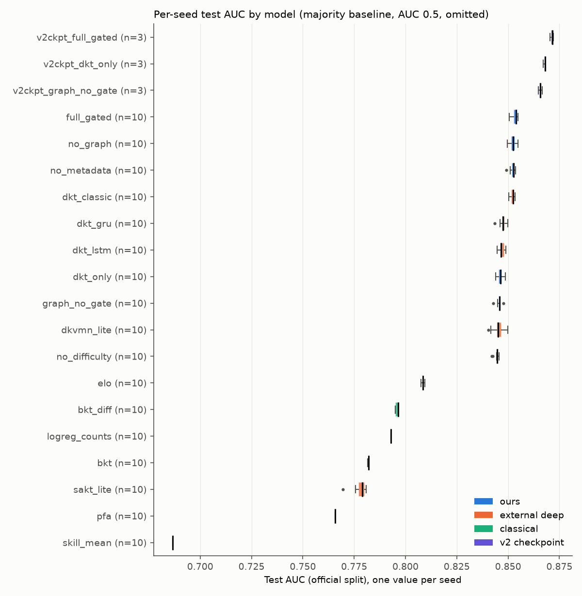
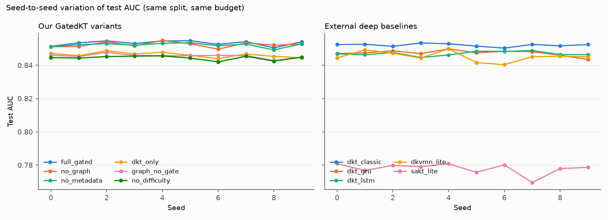

# Benchmark: deep models, our variants and classical baselines (Stage 5)

Generated by `python scripts/benchmark_seeds.py deep --seeds 10 --epochs 5 --workers 6` (report rebuilt with `python scripts/benchmark_seeds.py report`).
Seeds: 0..9 (10). Training wall time of the last run: 44.5 min - above the 30-40 min target. The only size reduction applied is 15 -> 5 epochs (all models alike); it was not reduced further so that every model still gets the same multi-epoch budget. Use --seeds/--epochs/--max_students for a shorter run.

## Protocol

- Data: ASSISTments 2009 skill-builder, official student split of the main model (train 2495 / val 311 / test 313 students), sequences truncated at 500, train-derived difficulty buckets.
- Every deep model (external baselines and our variants) is trained from scratch for each seed with the SAME reduced budget: 5 epochs, Adam 1e-3, batch 32 (length-bucketed), best-validation-AUC weights, 1 CPU thread per run. This is a reduction from the 15 epochs of the v2 training, made so the run fits the time budget; absolute AUCs are therefore lower than fully trained models and the ranking could change with longer training. All models get the same budget.
- Reference rows `v2ckpt_*`: the existing v2 checkpoints (15 epochs, seeds 42/123/2024), scored read-only.
- Classical models are fitted on the same train students; deterministic ones have one value for all seeds.

Two separate sources of uncertainty are reported:
- **Seed uncertainty**: mean, std (ddof=1), variance and t-based 95% CI of the per-seed test AUC.
- **Test-sample uncertainty**: paired bootstrap over the 313 test students (1000 resamples, students drawn with replacement, all of a student's predictions kept together), applied to the seed-averaged AUC. Columns marked 'boot'.

## Results (sorted by mean test AUC)

| Model | Family | Seeds | AUC mean | AUC std | AUC var | 95% CI (seeds) | 95% CI (boot) | ACC | Brier | ECE |
|---|---|---|---|---|---|---|---|---|---|---|
| v2ckpt_full_gated | v2 checkpoint | 3 | 0.8713 | 0.0008 | 6.24e-07 | [0.8693, 0.8733] | - | 0.8014 | 0.1344 | 0.0262 |
| v2ckpt_dkt_only | v2 checkpoint | 3 | 0.8677 | 0.0006 | 3.85e-07 | [0.8662, 0.8692] | - | 0.7963 | 0.1366 | 0.0235 |
| v2ckpt_graph_no_gate | v2 checkpoint | 3 | 0.8657 | 0.0009 | 8.71e-07 | [0.8633, 0.8680] | - | 0.7976 | 0.1370 | 0.0219 |
| full_gated | ours | 10 | 0.8533 | 0.0015 | 2.21e-06 | [0.8523, 0.8544] | [0.8267, 0.8774] | 0.7906 | 0.1432 | 0.0188 |
| no_graph | ours | 10 | 0.8524 | 0.0015 | 2.37e-06 | [0.8513, 0.8535] | [0.8257, 0.8764] | 0.7903 | 0.1435 | 0.0207 |
| no_metadata | ours | 10 | 0.8522 | 0.0013 | 1.61e-06 | [0.8513, 0.8531] | [0.8250, 0.8767] | 0.7895 | 0.1440 | 0.0199 |
| dkt_classic | external deep | 10 | 0.8521 | 0.0009 | 8.19e-07 | [0.8515, 0.8528] | [0.8240, 0.8789] | 0.7914 | 0.1428 | 0.0136 |
| dkt_gru | external deep | 10 | 0.8474 | 0.0017 | 2.99e-06 | [0.8461, 0.8486] | [0.8194, 0.8724] | 0.7882 | 0.1460 | 0.0171 |
| dkt_lstm | external deep | 10 | 0.8470 | 0.0013 | 1.68e-06 | [0.8461, 0.8479] | [0.8195, 0.8718] | 0.7881 | 0.1459 | 0.0142 |
| dkt_only | ours | 10 | 0.8463 | 0.0015 | 2.18e-06 | [0.8452, 0.8473] | [0.8188, 0.8712] | 0.7884 | 0.1464 | 0.0168 |
| graph_no_gate | ours | 10 | 0.8456 | 0.0012 | 1.54e-06 | [0.8447, 0.8465] | [0.8178, 0.8706] | 0.7874 | 0.1470 | 0.0195 |
| dkvmn_lite | external deep | 10 | 0.8453 | 0.0030 | 8.93e-06 | [0.8431, 0.8474] | [0.8167, 0.8718] | 0.7833 | 0.1478 | 0.0232 |
| no_difficulty | ours | 10 | 0.8445 | 0.0012 | 1.53e-06 | [0.8436, 0.8453] | [0.8142, 0.8724] | 0.7876 | 0.1454 | 0.0168 |
| elo | classical | 10 | 0.8085 | 0.0006 | 3.18e-07 | [0.8081, 0.8089] | [0.7789, 0.8369] | 0.7535 | 0.1674 | 0.0552 |
| bkt_diff | classical | 10 | 0.7959 | 0.0007 | 5.11e-07 | [0.7954, 0.7965] | [0.7589, 0.8289] | 0.7501 | 0.1686 | 0.0274 |
| logreg_counts | classical | 10 | 0.7930 | 0.0000 | 0.00e+00 | [0.7930, 0.7930] | [0.7633, 0.8212] | 0.7396 | 0.1710 | 0.0301 |
| bkt | classical | 10 | 0.7820 | 0.0002 | 3.90e-08 | [0.7818, 0.7821] | [0.7408, 0.8188] | 0.7466 | 0.1714 | 0.0159 |
| sakt_lite | external deep | 10 | 0.7779 | 0.0034 | 1.16e-05 | [0.7755, 0.7804] | [0.7522, 0.8024] | 0.7365 | 0.1753 | 0.0289 |
| pfa | classical | 10 | 0.7657 | 0.0000 | 1.37e-32 | [0.7657, 0.7657] | [0.7360, 0.7935] | 0.7218 | 0.1810 | 0.0323 |
| skill_mean | classical | 10 | 0.6866 | 0.0000 | 0.00e+00 | [0.6866, 0.6866] | [0.6550, 0.7161] | 0.6842 | 0.2049 | 0.0507 |
| majority | classical | 10 | 0.5000 | 0.0000 | 0.00e+00 | [0.5000, 0.5000] | [0.5000, 0.5000] | 0.6662 | 0.2224 | 0.0077 |

## Significance: full_gated vs every other model

Difference = AUC(full_gated) - AUC(model), paired by seed. Primary test: paired t-test over seeds with Holm correction over all comparisons; Wilcoxon signed-rank (Holm-corrected) as a check; effect size Cohen's d_z = mean difference / std of differences. Verdict rule (fixed before the run): 'improves over X' only if the Holm-corrected t-test p < 0.05 and both the seed CI and the bootstrap CI of the difference exclude 0; otherwise 'comparable' (or 'worse than X' if significant in the other direction). For deterministic classical models the per-seed difference varies only through full_gated's seeds.

| Model | Family | Pairs | Diff mean | 95% CI (seeds) | 95% CI (boot) | t p (Holm) | Wilcoxon p (Holm) | d_z | Verdict |
|---|---|---|---|---|---|---|---|---|---|
| majority | classical | 10 | +0.3533 | [+0.3523, +0.3544] | [+0.3267, +0.3774] | <1e-4 | 0.0332 | 237.42 | improves over majority |
| skill_mean | classical | 10 | +0.1667 | [+0.1657, +0.1678] | [+0.1353, +0.2005] | <1e-4 | 0.0332 | 112.04 | improves over skill_mean |
| pfa | classical | 10 | +0.0876 | [+0.0865, +0.0886] | [+0.0761, +0.1000] | <1e-4 | 0.0332 | 58.85 | improves over pfa |
| sakt_lite | external deep | 10 | +0.0754 | [+0.0725, +0.0783] | [+0.0629, +0.0891] | <1e-4 | 0.0332 | 18.59 | improves over sakt_lite |
| bkt | classical | 10 | +0.0714 | [+0.0702, +0.0725] | [+0.0559, +0.0890] | <1e-4 | 0.0332 | 45.39 | improves over bkt |
| logreg_counts | classical | 10 | +0.0603 | [+0.0593, +0.0614] | [+0.0500, +0.0723] | <1e-4 | 0.0332 | 40.55 | improves over logreg_counts |
| bkt_diff | classical | 10 | +0.0574 | [+0.0560, +0.0587] | [+0.0449, +0.0732] | <1e-4 | 0.0332 | 30.83 | improves over bkt_diff |
| elo | classical | 10 | +0.0449 | [+0.0437, +0.0460] | [+0.0379, +0.0526] | <1e-4 | 0.0332 | 27.84 | improves over elo |
| no_difficulty | ours | 10 | +0.0089 | [+0.0080, +0.0097] | [+0.0042, +0.0143] | <1e-4 | 0.0332 | 7.37 | improves over no_difficulty |
| dkvmn_lite | external deep | 10 | +0.0080 | [+0.0059, +0.0102] | [+0.0051, +0.0111] | <1e-4 | 0.0332 | 2.66 | improves over dkvmn_lite |
| graph_no_gate | ours | 10 | +0.0077 | [+0.0068, +0.0087] | [+0.0064, +0.0092] | <1e-4 | 0.0332 | 6.03 | improves over graph_no_gate |
| dkt_only | ours | 10 | +0.0070 | [+0.0058, +0.0083] | [+0.0057, +0.0085] | <1e-4 | 0.0332 | 4.07 | improves over dkt_only |
| dkt_lstm | external deep | 10 | +0.0063 | [+0.0051, +0.0075] | [+0.0050, +0.0076] | <1e-4 | 0.0332 | 3.69 | improves over dkt_lstm |
| dkt_gru | external deep | 10 | +0.0060 | [+0.0046, +0.0073] | [+0.0046, +0.0074] | <1e-4 | 0.0332 | 3.08 | improves over dkt_gru |
| dkt_classic | external deep | 10 | +0.0012 | [+0.0000, +0.0024] | [-0.0031, +0.0060] | 0.0910 | 0.0977 | 0.73 | comparable |
| no_metadata | ours | 10 | +0.0011 | [+0.0008, +0.0014] | [+0.0003, +0.0020] | <1e-4 | 0.0332 | 2.75 | improves over no_metadata |
| no_graph | ours | 10 | +0.0009 | [+0.0000, +0.0019] | [+0.0004, +0.0016] | 0.0910 | 0.0977 | 0.72 | comparable |

## Input ablations (same protocol)

| Ablation | Model key | AUC mean (seeds) | Diff full - ablation | 95% CI (seeds) | 95% CI (boot) | Verdict |
|---|---|---|---|---|---|---|
| no metadata | no_metadata | 0.8522 | +0.0011 | [+0.0008, +0.0014] | [+0.0003, +0.0020] | full model better than no_metadata |
| no difficulty | no_difficulty | 0.8445 | +0.0089 | [+0.0080, +0.0097] | [+0.0042, +0.0143] | full model better than no_difficulty |
| no graph | no_graph | 0.8524 | +0.0009 | [+0.0000, +0.0019] | [+0.0004, +0.0016] | comparable |
| no gate | graph_no_gate | 0.8456 | +0.0077 | [+0.0068, +0.0087] | [+0.0064, +0.0092] | full model better than graph_no_gate |

## How to read this

- A verdict 'comparable' means the data do not show a difference under this protocol; it is not evidence that the models are equal.
- All deep models were trained with a reduced budget (see Protocol); compare the `v2ckpt_*` rows for the fully trained v2 checkpoints (3 seeds only).
- Files: benchmark.csv (summary), benchmark_seeds.csv (per model x seed), benchmark_significance.csv, benchmark_run_meta.json; cached predictions in data/processed_v3/benchmark_preds/.
