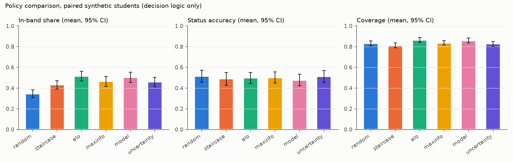
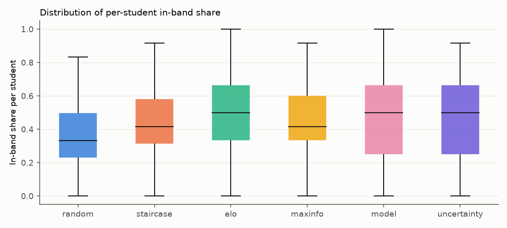
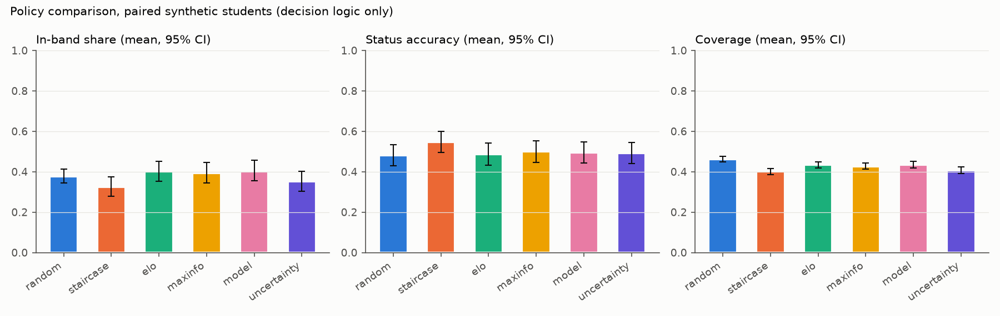
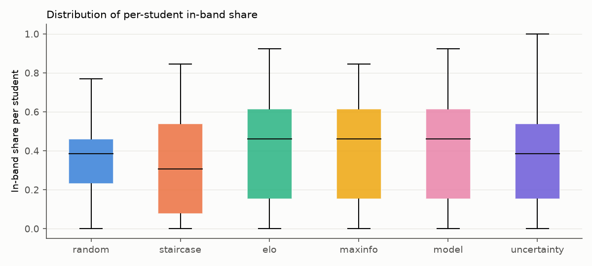

# Policy comparison (v3 Stage 9)

Generated by `python scripts/simulate_v3.py --students 100 --seed 2026` in 60s. Pre-registration: reports/v3/DEMO_CONFIG.md.

> **Scope.** Synthetic students validate the decision logic only (which level is served, how statuses are assigned). They are not drawn from real data, say nothing about learning gains, and are not a test of knowledge-tracing accuracy.

Primary setting (= current demo setting): {'SESSION_MODE': 'core5', 'TOPIC_SELECTION': 'evidence_blend', 'APPLY_CALIBRATION': 'true'}. 100 paired students per policy: the same abilities, the same topic randomness and the same answer random stream for every policy. Policy parameters fixed before the run: TARGET_P 0.7, max-information target 0.50, uncertainty spread limit 0.15, T_PROF 0.7, T_READY 0.6, MIN_ANSWERS 2. Profile reliable: true.

| Policy | In-band share | Status accuracy | Coverage | Answers to stable status | Ready-flag precision | Level mix E/M/H | Low-confidence flags / session |
|---|---|---|---|---|---|---|---|
| random | 34.5% ± 19.0% [30.7%, 38.3%] | 51.5% ± 29.1% [45.7%, 57.3%] (pooled 51.3%) | 83.0% ± 11.8% [80.6%, 85.4%] | 2.59 ± 0.40 [2.51, 2.67] | 46.6% of 58 flags | 32%/35%/32% | 0.00 |
| staircase | 43.2% ± 20.3% [39.1%, 47.2%] | 48.8% ± 30.5% [42.8%, 54.9%] (pooled 48.3%) | 81.2% ± 11.3% [79.0%, 83.4%] | 2.82 ± 0.45 [2.73, 2.91] | 40.7% of 54 flags | 34%/43%/22% | 0.00 |
| Elo/IRT target | 51.5% ± 23.5% [46.8%, 56.2%] | 49.8% ± 27.0% [44.4%, 55.1%] (pooled 49.5%) | 86.4% ± 11.7% [84.1%, 88.7%] | 2.57 ± 0.39 [2.49, 2.65] | 36.8% of 68 flags | 46%/45%/10% | 0.00 |
| max-information (CAT) | 46.4% ± 23.8% [41.7%, 51.1%] | 50.2% ± 26.6% [44.9%, 55.5%] (pooled 49.8%) | 83.6% ± 10.4% [81.5%, 85.7%] | 2.63 ± 0.38 [2.56, 2.71] | 31.9% of 47 flags | 32%/57%/10% | 0.00 |
| ZPD target 0.70 (model) | 50.3% ± 24.8% [45.4%, 55.3%] | 47.7% ± 28.0% [42.2%, 53.3%] (pooled 47.3%) | 85.8% ± 11.8% [83.5%, 88.1%] | 2.55 ± 0.34 [2.48, 2.62] | 30.2% of 53 flags | 43%/51%/6% | 0.00 |
| uncertainty-aware (ensemble) | 45.9% ± 23.0% [41.4%, 50.5%] | 51.1% ± 28.9% [45.3%, 56.8%] (pooled 50.4%) | 82.6% ± 11.9% [80.2%, 85.0%] | 2.71 ± 0.45 [2.62, 2.80] | 37.8% of 45 flags | 38%/47%/15% | 7.07 |

Cells: mean ± std over students [95% t-CI of the mean]. Status accuracy per student is averaged over the topics that received a status; 'pooled' = all hits / all statuses (the v2 gate statistic).

## Paired differences vs staircase

| Metric | Policy | Pairs | Mean diff | 95% CI (t) | 95% CI (bootstrap) | t-test p (Holm) | Wilcoxon p |
|---|---|---|---|---|---|---|---|
| inband | random | 100 | -8.7% | [-11.9%, -5.4%] | [-12.1%, -5.4%] | 0.0000 | 0.0000 |
| inband | elo | 100 | +8.3% | [+6.2%, +10.5%] | [+6.3%, +10.3%] | 0.0000 | 0.0000 |
| inband | maxinfo | 100 | +3.2% | [+1.0%, +5.5%] | [+1.0%, +5.5%] | 0.0117 | 0.0027 |
| inband | model | 100 | +7.2% | [+4.8%, +9.6%] | [+4.8%, +9.6%] | 0.0000 | 0.0000 |
| inband | uncertainty | 100 | +2.8% | [+0.7%, +4.8%] | [+0.8%, +4.8%] | 0.0117 | 0.0134 |
| status_acc | random | 100 | +2.7% | [-2.9%, +8.2%] | [-2.8%, +8.2%] | 1.0000 | 0.4220 |
| status_acc | elo | 100 | +0.9% | [-5.0%, +6.8%] | [-5.0%, +6.5%] | 1.0000 | 0.6189 |
| status_acc | maxinfo | 100 | +1.3% | [-4.3%, +7.0%] | [-4.2%, +6.9%] | 1.0000 | 0.5497 |
| status_acc | model | 100 | -1.1% | [-6.6%, +4.4%] | [-6.7%, +4.2%] | 1.0000 | 0.8495 |
| status_acc | uncertainty | 100 | +2.2% | [-3.2%, +7.6%] | [-3.0%, +7.9%] | 1.0000 | 0.5045 |
| coverage | random | 100 | +1.8% | [-1.1%, +4.7%] | [-1.0%, +4.6%] | 0.3252 | 0.3652 |
| coverage | elo | 100 | +5.2% | [+2.8%, +7.6%] | [+3.0%, +7.6%] | 0.0002 | 0.0004 |
| coverage | maxinfo | 100 | +2.4% | [-0.0%, +4.8%] | [+0.0%, +4.8%] | 0.1533 | 0.0249 |
| coverage | model | 100 | +4.6% | [+2.0%, +7.2%] | [+2.2%, +7.2%] | 0.0032 | 0.0037 |
| coverage | uncertainty | 100 | +1.4% | [-0.6%, +3.4%] | [-0.6%, +3.4%] | 0.3252 | 0.3863 |
| to_stable | random | 100 | -0.24 | [-0.32, -0.15] | [-0.32, -0.16] | 0.0000 | 0.0000 |
| to_stable | elo | 100 | -0.25 | [-0.34, -0.16] | [-0.34, -0.16] | 0.0000 | 0.0000 |
| to_stable | maxinfo | 100 | -0.19 | [-0.27, -0.11] | [-0.27, -0.11] | 0.0000 | 0.0000 |
| to_stable | model | 100 | -0.27 | [-0.35, -0.19] | [-0.35, -0.20] | 0.0000 | 0.0000 |
| to_stable | uncertainty | 100 | -0.11 | [-0.18, -0.04] | [-0.18, -0.04] | 0.0025 | 0.0033 |
| ready_prec | random | 23 | -6.5% | [-22.9%, +9.8%] | [-21.7%, +6.5%] | 0.9119 | 0.3795 |
| ready_prec | elo | 28 | -5.7% | [-23.9%, +12.6%] | [-22.9%, +11.9%] | 0.9119 | 0.5254 |
| ready_prec | maxinfo | 21 | -11.1% | [-29.7%, +7.5%] | [-27.8%, +5.6%] | 0.9119 | 0.2423 |
| ready_prec | model | 27 | -16.0% | [-33.6%, +1.5%] | [-34.0%, +0.0%] | 0.3596 | 0.0879 |
| ready_prec | uncertainty | 21 | -8.7% | [-23.8%, +6.4%] | [-23.8%, +4.0%] | 0.9119 | 0.2926 |

**Uncertainty-aware policy:** the ensemble spread exceeded the pre-registered limit (0.15) on 7.07 of 12.00 level decisions per session (59%); those decisions used the staircase level. Its results therefore largely reflect the staircase rule, not the ensemble prediction.

## Exploratory (not used by any gate)

Same students and policies in the v2 simulation setting (full10, model topic selection, no calibration).

| Policy | In-band share | Status accuracy | Coverage | Answers to stable status | Ready-flag precision | Level mix E/M/H | Low-confidence flags / session |
|---|---|---|---|---|---|---|---|
| random | 37.8% ± 17.1% [34.5%, 41.2%] | 48.2% ± 26.1% [43.1%, 53.4%] (pooled 47.4%) | 46.2% ± 7.1% [44.8%, 47.6%] | 2.34 ± 0.21 [2.30, 2.38] | 64.5% of 31 flags | 33%/35%/32% | 0.00 |
| staircase | 32.6% ± 24.4% [27.8%, 37.5%] | 54.7% ± 26.3% [49.4%, 59.9%] (pooled 53.4%) | 40.1% ± 7.8% [38.5%, 41.7%] | 2.59 ± 0.24 [2.54, 2.63] | 60.5% of 43 flags | 2%/58%/40% | 0.00 |
| Elo/IRT target | 40.2% ± 24.6% [35.3%, 45.0%] | 48.8% ± 27.2% [43.3%, 54.2%] (pooled 47.5%) | 43.4% ± 7.7% [41.9%, 44.9%] | 2.26 ± 0.25 [2.21, 2.31] | 48.1% of 27 flags | 4%/78%/18% | 0.00 |
| max-information (CAT) | 39.5% ± 25.6% [34.4%, 44.5%] | 50.0% ± 26.8% [44.7%, 55.3%] (pooled 48.7%) | 42.7% ± 7.5% [41.2%, 44.2%] | 2.32 ± 0.22 [2.28, 2.36] | 43.8% of 32 flags | 3%/74%/22% | 0.00 |
| ZPD target 0.70 (model) | 40.5% ± 25.7% [35.4%, 45.6%] | 49.5% ± 26.6% [44.2%, 54.7%] (pooled 48.3%) | 43.5% ± 8.1% [41.9%, 45.1%] | 2.26 ± 0.20 [2.22, 2.30] | 42.9% of 35 flags | 4%/78%/18% | 0.00 |
| uncertainty-aware (ensemble) | 35.2% ± 24.7% [30.3%, 40.1%] | 49.3% ± 26.3% [44.1%, 54.5%] (pooled 48.4%) | 40.7% ± 7.9% [39.1%, 42.3%] | 2.49 ± 0.25 [2.44, 2.54] | 51.4% of 37 flags | 2%/65%/33% | 7.64 |

Cells: mean ± std over students [95% t-CI of the mean]. Status accuracy per student is averaged over the topics that received a status; 'pooled' = all hits / all statuses (the v2 gate statistic).

## Paired differences vs staircase

| Metric | Policy | Pairs | Mean diff | 95% CI (t) | 95% CI (bootstrap) | t-test p (Holm) | Wilcoxon p |
|---|---|---|---|---|---|---|---|
| inband | random | 100 | +5.2% | [+1.3%, +9.2%] | [+1.2%, +9.2%] | 0.0099 | 0.0044 |
| inband | elo | 100 | +7.5% | [+5.4%, +9.6%] | [+5.4%, +9.7%] | 0.0000 | 0.0000 |
| inband | maxinfo | 100 | +6.8% | [+4.8%, +8.9%] | [+5.0%, +8.8%] | 0.0000 | 0.0000 |
| inband | model | 100 | +7.9% | [+5.8%, +10.0%] | [+5.8%, +10.0%] | 0.0000 | 0.0000 |
| inband | uncertainty | 100 | +2.6% | [+1.3%, +3.9%] | [+1.5%, +3.8%] | 0.0002 | 0.0001 |
| status_acc | random | 100 | -6.4% | [-12.8%, +0.0%] | [-12.5%, -0.1%] | 0.1513 | 0.0733 |
| status_acc | elo | 100 | -5.9% | [-11.2%, -0.6%] | [-11.0%, -0.7%] | 0.1405 | 0.0347 |
| status_acc | maxinfo | 100 | -4.7% | [-10.0%, +0.7%] | [-10.1%, +0.6%] | 0.1513 | 0.0780 |
| status_acc | model | 100 | -5.2% | [-10.7%, +0.3%] | [-10.5%, +0.0%] | 0.1513 | 0.1050 |
| status_acc | uncertainty | 100 | -5.4% | [-10.2%, -0.6%] | [-10.0%, -0.8%] | 0.1405 | 0.0253 |
| coverage | random | 100 | +6.1% | [+4.6%, +7.6%] | [+4.6%, +7.7%] | 0.0000 | 0.0000 |
| coverage | elo | 100 | +3.3% | [+2.1%, +4.5%] | [+2.1%, +4.5%] | 0.0000 | 0.0000 |
| coverage | maxinfo | 100 | +2.6% | [+1.5%, +3.7%] | [+1.5%, +3.8%] | 0.0000 | 0.0001 |
| coverage | model | 100 | +3.4% | [+2.2%, +4.6%] | [+2.3%, +4.6%] | 0.0000 | 0.0000 |
| coverage | uncertainty | 100 | +0.6% | [-0.2%, +1.4%] | [-0.2%, +1.4%] | 0.1583 | 0.2012 |
| to_stable | random | 100 | -0.25 | [-0.31, -0.19] | [-0.31, -0.19] | 0.0000 | 0.0000 |
| to_stable | elo | 100 | -0.33 | [-0.38, -0.27] | [-0.38, -0.28] | 0.0000 | 0.0000 |
| to_stable | maxinfo | 100 | -0.26 | [-0.32, -0.21] | [-0.32, -0.21] | 0.0000 | 0.0000 |
| to_stable | model | 100 | -0.33 | [-0.38, -0.28] | [-0.38, -0.28] | 0.0000 | 0.0000 |
| to_stable | uncertainty | 100 | -0.10 | [-0.14, -0.06] | [-0.14, -0.06] | 0.0000 | 0.0000 |
| ready_prec | random | 10 | -20.0% | [-68.3%, +28.3%] | [-60.0%, +20.0%] | 1.0000 | 0.5000 |
| ready_prec | elo | 11 | -29.5% | [-63.8%, +4.7%] | [-61.4%, +0.0%] | 0.4184 | 0.1250 |
| ready_prec | maxinfo | 10 | +2.5% | [-40.9%, +45.9%] | [-30.0%, +40.0%] | 1.0000 | 1.0000 |
| ready_prec | model | 11 | -12.9% | [-47.0%, +21.2%] | [-39.4%, +15.9%] | 1.0000 | 0.5000 |
| ready_prec | uncertainty | 16 | -1.6% | [-20.1%, +16.9%] | [-15.6%, +17.2%] | 1.0000 | 0.6803 |

**Uncertainty-aware policy:** the ensemble spread exceeded the pre-registered limit (0.15) on 7.64 of 13.00 level decisions per session (59%); those decisions used the staircase level. Its results therefore largely reflect the staircase rule, not the ensemble prediction.

