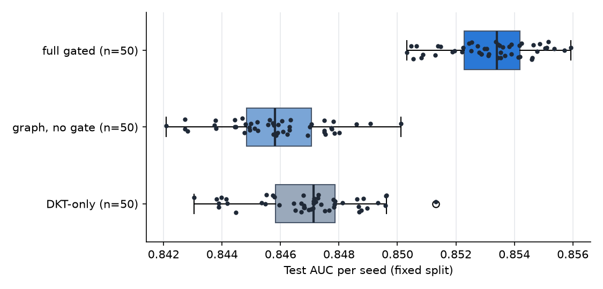
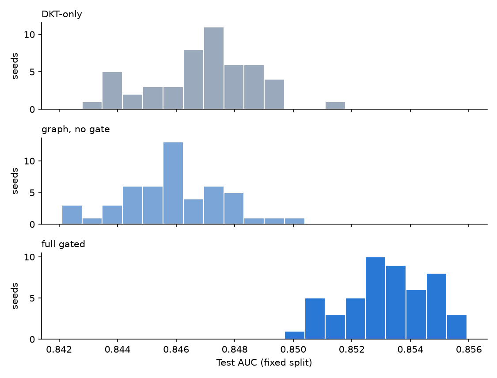

# Our models over many seeds: variance of test AUC

Generated by `python scripts/run_seeds.py` from reports/v3/seeds.csv (fixed split) and reports/v3/seeds_resplit.csv (student re-split). Plan and timing: reports/v3/seeds_plan.json.

## Setup

- Models: DKT-only, graph, no gate, full gated; our training path (src/baselines/ours.py on src/model.py), Adam 1e-3, batch 32, best-validation weights; inputs as in the existing model (skill, correct, difficulty bucket, response time, attempts, hints). No checkpoint saved.
- Fixed split (official ASSISTments split): a seed changes initialisation and batch order only; the test set (31020 predictions) is identical for every seed.
- Budget per run: 5 epochs, early stopping patience 3; training students: all.
- Seeds requested: 50; seeds used: DKT-only 50, graph, no gate 50, full gated 50.
- Timing: one epoch took up to 51 s per run with 6 runs in parallel; estimated 6.38 h for the requested setting, 2.12 h for the chosen one (budget 3.5 h).
- Reductions: epochs reduced from 15 to 5, early stopping with patience 3.

## Fixed split: test AUC over seeds

| Model | Seeds | Mean | Std | Variance | Min | Max | 95% CI (mean) | Mean val AUC | Brier | ECE |
|---|---|---|---|---|---|---|---|---|---|---|
| DKT-only | 50 | 0.8469 | 0.0018 | 3.21e-06 | 0.8430 | 0.8513 | [0.8464, 0.8475] | 0.8710 | 0.1459 | 0.0145 |
| graph, no gate | 50 | 0.8459 | 0.0017 | 2.88e-06 | 0.8421 | 0.8501 | [0.8454, 0.8463] | 0.8698 | 0.1466 | 0.0155 |
| full gated | 50 | 0.8532 | 0.0015 | 2.13e-06 | 0.8503 | 0.8559 | [0.8528, 0.8536] | 0.8777 | 0.1430 | 0.0171 |

## Full gated against each other model (matched seeds)

Paired t-test over matched seeds (Holm-corrected), Wilcoxon signed-rank as a check, effect size Cohen's d_z (mean paired difference / its std). "improves" only if the corrected p < 0.05 and the 95% CI of the paired difference excludes 0; "worse" symmetrically; otherwise "comparable".

| vs | Pairs | Mean diff (full gated - X) | 95% CI | d_z | Seeds full gated higher | t p (Holm) | Wilcoxon p | Verdict |
|---|---|---|---|---|---|---|---|---|
| DKT-only | 50 | +0.0062 | [+0.0058, +0.0067] | +3.70 | 50/50 | 2e-30 | 1.8e-15 | **improves** |
| graph, no gate | 50 | +0.0073 | [+0.0070, +0.0077] | +5.66 | 50/50 | 8.7e-39 | 1.8e-15 | **improves** |

## Variance compared with the gain

- vs DKT-only: the mean difference (+0.0062) is 4.3x the seed-to-seed std of the full gated model (0.0015); the full gated model scored higher on 50 of 50 matched seeds. The difference is larger than the seed noise.
- vs graph, no gate: the mean difference (+0.0073) is 5.0x the seed-to-seed std of the full gated model (0.0015); the full gated model scored higher on 50 of 50 matched seeds. The difference is larger than the seed noise.

## Separate experiment: the student split changes with the seed

10 seeds; each seed draws a new 80/10/10 student split (difficulty buckets and skill graph from that seed's train students only), same budget as above. This variance includes which students are in the test set, so it is not comparable to the fixed-split variance above.

| Model | Splits | Mean | Std | Variance | Min | Max | 95% CI (mean) |
|---|---|---|---|---|---|---|---|
| DKT-only | 10 | 0.8407 | 0.0148 | 2.18e-04 | 0.8200 | 0.8701 | [0.8301, 0.8513] |
| graph, no gate | 10 | 0.8402 | 0.0142 | 2.02e-04 | 0.8209 | 0.8683 | [0.8300, 0.8503] |
| full gated | 10 | 0.8469 | 0.0138 | 1.92e-04 | 0.8286 | 0.8741 | [0.8370, 0.8568] |

| vs (re-split, matched splits) | Pairs | Mean diff | 95% CI | d_z | t p (Holm) | Verdict |
|---|---|---|---|---|---|---|
| DKT-only | 10 | +0.0062 | [+0.0046, +0.0078] | +2.74 | 1.2e-05 | **improves** |
| graph, no gate | 10 | +0.0067 | [+0.0056, +0.0078] | +4.31 | 5.2e-07 | **improves** |

Std of the full gated test AUC: 0.0015 over seeds on the fixed split vs 0.0138 over student re-splits.
